# BeforePull

[](https://github.com/4Asterion/beforepull/actions/workflows/ci.yml)


[](LICENSE)

**`git diff` for the security of your Docker Compose stack.** Before you `docker compose pull && up -d`, BeforePull tells you what the new version actually changes: a container that became privileged, a port that is suddenly public, the Docker socket mounted into a sidecar, a data volume that disappeared, a major database upgrade — or a downgrade you can't take back.

<p align="center"></p>

Read-only by design: it never pulls, starts, or modifies containers, never prints environment variable values, and has no telemetry.

## Use it in pull requests

Add one workflow and every PR that touches your Compose file gets a findings table in its job summary — and fails on anything `high` or worse:

```yaml
# .github/workflows/compose-preflight.yml
on:
  pull_request:
    paths: ['docker-compose.yml']
jobs:
  preflight:
    runs-on: ubuntu-latest
    steps:
      - uses: actions/checkout@v7
      - uses: 4Asterion/beforepull@v0
        with:
          compose-file: docker-compose.yml
          fail-on: high   # none | critical | high | medium | low
```

The action builds BeforePull from source, normalises both versions with `docker compose config` (already on GitHub's Ubuntu runners), and writes a Markdown report.

## Install

Tagged versions publish binaries on [Releases](https://github.com/4Asterion/beforepull/releases) (Linux, macOS, Windows; amd64 and arm64, with `SHA256SUMS`). Or build with Go 1.23+:

```sh
go install github.com/4Asterion/beforepull/cmd/beforepull@latest
```

## Usage

```sh
# Compose YAML (needs the Docker Compose v2 plugin for normalisation)
beforepull compare --current docker-compose.yml --target next/docker-compose.yml

# Exported canonical JSON (no Docker needed; e.g. `docker compose config --format json > current.json`)
beforepull compare --current current.json --target target.json --format html --output report.html

# CI gate + Markdown for PR comments
beforepull compare --current old.yml --target new.yml --format markdown --fail-on high >> "$GITHUB_STEP_SUMMARY"
```

Formats: `text` (default), `json` (schema v1, see [docs/ARCHITECTURE.md](docs/ARCHITECTURE.md)), standalone `html` ([example](docs/example-report.html)), `markdown`.

Exit codes: **0** nothing at or above `--fail-on` (default `none`), **3** threshold met, **2** invalid input or processing failure. Report files are written with owner-only permissions.

## What it detects

| Severity | Change |
|---|---|
| Critical | Privileged mode enabled · Docker/Podman/containerd socket mounted · `cap_add: ALL` or `SYS_ADMIN` |
| High | Port exposed publicly or widened beyond loopback · host network/PID/IPC/userns namespace · user switched to root (`root`, `0`, `root:root`, `0:0`) · read-only root filesystem disabled · seccomp/AppArmor/SELinux disabled · host device mapped · sensitive host path bind-mounted (`/`, `/etc`, `/root`, `/proc`, …) · persistent mount removed · secret removed · Linux capability added · major version upgrade · **version downgrade** · image repository switched · service removed |
| Medium | Explicit non-root user removed · `no-new-privileges` removed · dropped capability restored · environment variable **key** removed · healthcheck or memory limit removed · dependency removed · mutable tag (`latest`/no tag) · new service · mount added · loopback-only port added |
| Low | CPU limit removed |

New services are checked against an empty definition, so a privileged or socket-mounting sidecar is reported, not just "service added". Version detection reads the image tag (`16`, `1.27-alpine`, `v2.0.1`), ignores registry ports, and skips git-SHA and date tags; it is a heuristic and can be wrong for images without semver-style tags.

## Opt-in registry inspection

```sh
beforepull manifest --image alpine:3.20
```

Reads manifest metadata over the OCI distribution API with anonymous bearer tokens, verifies the `Docker-Content-Digest`, and lists OS/architecture variants of an image index. No layers are pulled; private registries needing credentials are not supported yet.

## Security boundaries

- `compare` never contacts a registry or the Docker Engine. For YAML it runs only `docker compose config --format json` in the file's directory; never `up`, `pull` or `exec`.
- Compose normalisation resolves environment variables and may read `.env` / `env_file` files. Values never appear in findings, but the local Docker CLI sees them, so don't run it on untrusted Compose files with production secrets in the environment.
- `manifest` is a separate, explicitly requested network action.
- Reports exclude secret values, but service names, mount paths and image names may still be sensitive.

## Scope

BeforePull compares configuration. It cannot know whether a migration is reversible, a backup restorable, or an image compatible with your existing data — it tells you exactly where to look. See [docs/ROADMAP.md](docs/ROADMAP.md) for what's next.

## Development

```sh
go test -race ./...
go vet ./...
```

See [CONTRIBUTING.md](CONTRIBUTING.md), [SECURITY.md](SECURITY.md) and [CHANGELOG.md](CHANGELOG.md). MIT licensed.
